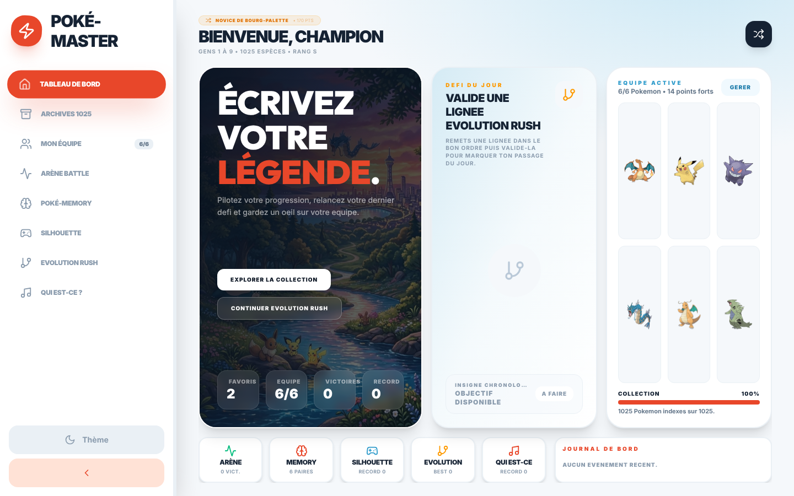
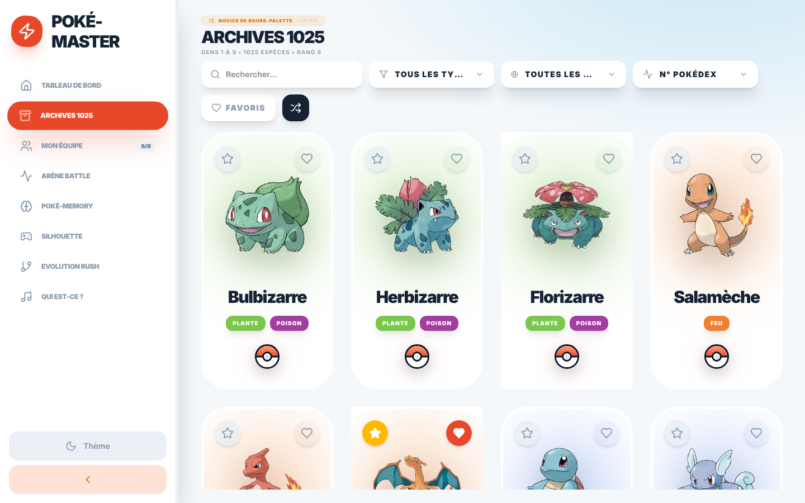
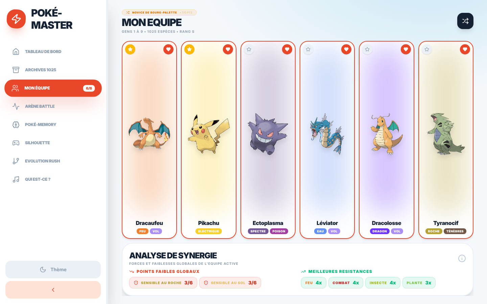
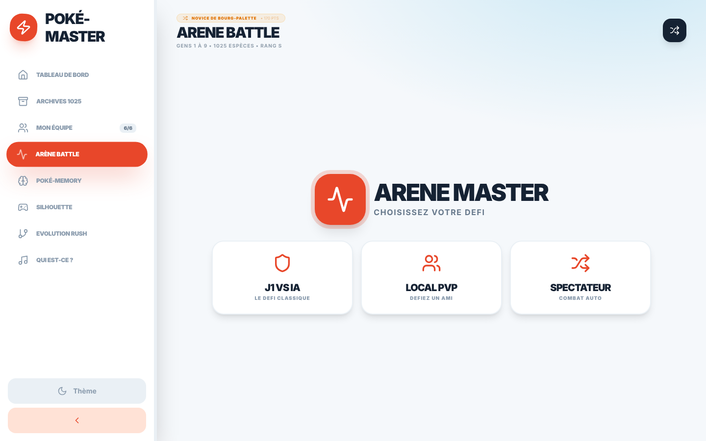

# Poké-Master

Poké-Master est un Pokédex moderne construit avec React et Vite. L'application combine une collection locale de 1025 Pokémon, un tableau de bord de progression, la gestion d'équipe, des favoris et plusieurs mini-jeux autour de l'univers Pokémon.

## Aperçu

- Tableau de bord avec progression, défi du jour, statistiques et historique d'activité
- Collection de 1025 Pokémon avec recherche, tri, filtres par type et génération
- Fiches détaillées avec navigation, comparaison et ajout aux favoris
- Gestion d'équipe jusqu'à 6 Pokémon avec analyse de synergie
- Arène de combat (J1 vs IA, PvP local, spectateur) avec illustrations des Pokémon
- Mini-jeux inclus :
  - `Silhouette`
  - `Poké-Memory`
  - `Evolution Rush`
  - `Cry Quiz` (« Qui est-ce ? »)

## Captures d'écran

### Tableau de bord



### Collection



### Équipe et synergie



### Arène de combat



## Charte graphique

| Rôle | Couleur | Utilisation |
|---|---|---|
| Amber Red | `#E8472A` (classes `brand-*`) | Accent principal : boutons, onglet actif, alertes |
| Sky Blue | `#87CEEB` (classes `sky-*`) | Accent secondaire : lueurs, statistiques, ciel de l'arène |
| Cloudy White | `#F5F8FB` (classes `slate-*`) | Fonds clairs ; son pendant « nuit bleutée » en mode sombre |

Les échelles sont définies une seule fois dans `src/index.css` (bloc `@theme`) : changer une valeur suffit à recolorer toute l'application.

## Stack technique

- React 19
- Vite 6
- Tailwind CSS 4
- Framer Motion
- Lucide React
- Vitest + Testing Library

## Lancement du projet

```bash
npm install
npm run dev
```

Vite démarre ensuite l'application en local, en général sur `http://localhost:5173`.

## Scripts disponibles

```bash
npm run dev
npm run build
npm run preview
npm run lint
npm run test
npm run test:watch
```

## Données et fonctionnement

- Les données du Pokédex sont chargées depuis `public/pokedex.json`
- L'état utilisateur est conservé dans le `localStorage` :
  - équipe
  - favoris
  - thème
  - activité quotidienne
  - dernier onglet joué
- Les fiches détaillées (évolutions, attaques, taille/poids) et les cris Pokémon du quiz audio sont récupérés depuis PokeAPI, puis mis en cache dans le `localStorage`
- Les lectures du `localStorage` sont tolérantes : une donnée corrompue est ignorée au lieu de faire planter l'application

## Arborescence utile

- `src/App.jsx` : orchestration générale de l'application
- `src/components/` : pages, layout, modales, cartes et mini-jeux
- `src/hooks/` : logique métier, persistance locale et gestion des jeux
- `src/lib/` : utilitaires partagés (`cn`, lecture sûre du `localStorage`)
- `src/utils/` : logique pure des mini-jeux
- `src/constants/` : métadonnées des modes, types et générations
- `src/test/` : tests Vitest et Testing Library
- `public/pokedex.json` : dataset local des 1025 Pokémon
- `screenshots/` : captures utilisées dans la documentation

## Vérification

Avant de proposer une modification, ces trois commandes doivent passer :

```bash
npm run lint
npm run test
npm run build
```
